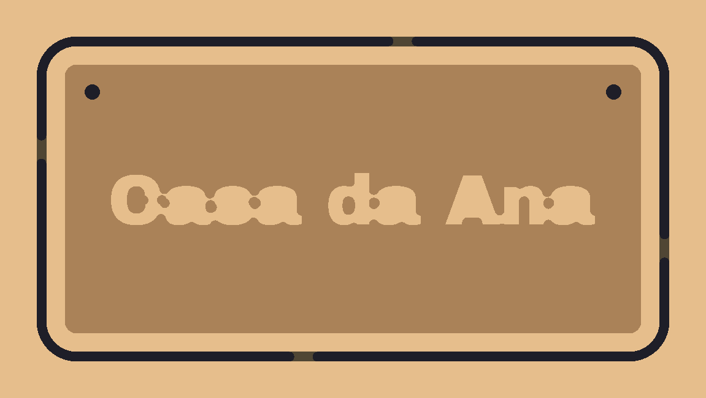
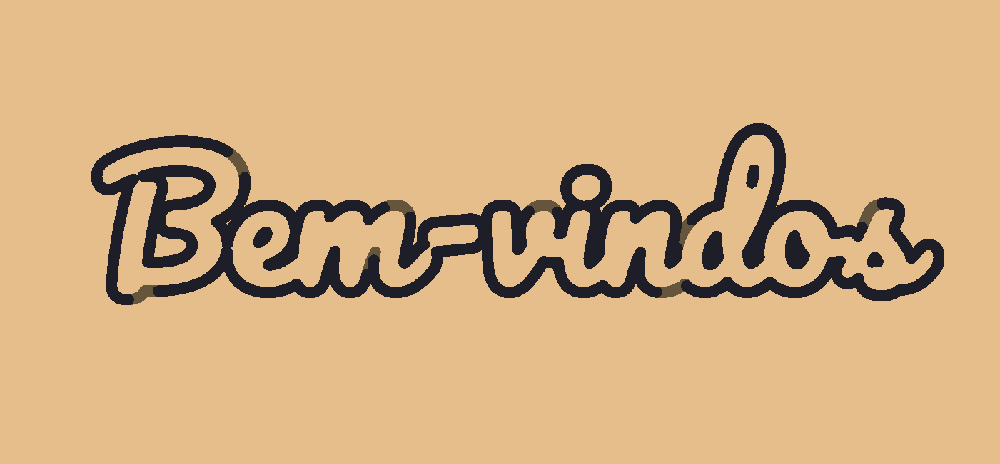
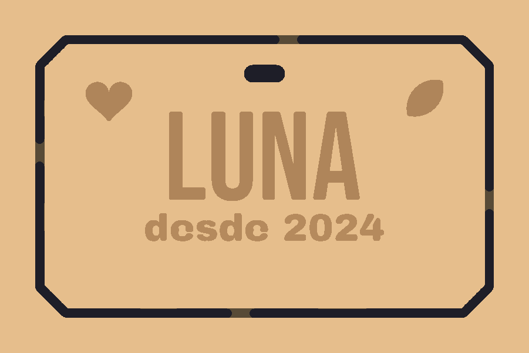

# cam-engine: CAM 2.5D de placas e letreiros

O motor que resolve "o gSender não cria nada". Ele recebe a especificação JSON que o assistente de IA preenche e devolve um **G-code GRBL já verificado**. Junto vêm avisos de fabricabilidade em português e a geometria para a prévia.

```
especificação JSON  →  layout 2D  →  toolpaths  →  G-code GRBL  →  verificador  →  (simulação)
   (IA / UI)          (opentype.js     (pocket,      (pós-proc.)     (relê o texto
                       + Clipper2)      perfil, abas)                 final)
```

Não depende de interface. Roda no Node (testes, CLI, servidor do gSender) e no navegador (worker).

## O que já faz (v1)

| Peça | Como |
|---|---|
| **Placa** com borda reta, arredondada ou chanfrada | contorno paramétrico |
| **Texto** em relevo, gravado ou vazado (estêncil) | `opentype.js` → contornos → união NonZero |
| **Letreiro recortado**, com letras soltas ou ligadas (cursiva) | união das letras + recorte por fora, recortando também os miolos |
| **Ícones** (coração, estrela, casa, folha) | polígonos paramétricos |
| **Furos e rasgos** para fixar ou pendurar | furo em bicadas quando o furo tem o diâmetro da fresa, senão pocket |
| **Pocket** (relevo, gravação) | anéis concêntricos de offset do Clipper2, de dentro para fora, ficando no fundo entre anéis quando é seguro |
| **Recorte externo com abas** | passadas em profundidade; a fresa sobe nas abas nas passadas finais |
| **Duas fresas** (ex.: 1/16" grava, 1/8" recorta) | troca com `T# M6`, tratada pelo gSender |
| **Parâmetros de corte** por material | RPM, avanço = avanço por dente × canais × RPM, mergulho, passada e sobreposição |
| **Verificador** | só comandos permitidos, mm/absoluto, sem `$`, sem G0 dentro do material, limites de área/Z/avanço/RPM; tempo estimado |
| **Simulação** por mapa de alturas | mesma ideia do `carve.ts` do rudra496/cnc, reescrita sem Three.js |

### Avisos de fabricabilidade

Cada aviso tem um `codigo` estável (para a UI e a IA reagirem), uma `mensagem` humana e uma `sugestao`. Exemplos:

- `TEXTO_NAO_CABE`: traz o tamanho sugerido em `dados.tamanhoSugerido`.
- `ELEMENTO_NAO_USINAVEL`: os traços são mais finos que a fresa e nada seria cortado.
- `DETALHE_MENOR_QUE_FRESA`: informa o % da área que não será cortado.
- `PROFUNDIDADE_EXCEDE`, `FERRAMENTA_CURTA`, `FURO_MENOR_QUE_FRESA`, `FORA_DA_PECA`, `ILHAS_SOLTAS`, `PECA_MAIOR_QUE_MAQUINA`, `VBIT_SO_GRAVA`, `PECA_PEQUENA_SEM_ABA`.

Com qualquer aviso de severidade `erro`, `generatePlate` não devolve G-code (`ok: false`, `gcode: ""`).

## Simulações dos exemplos

| `casa-da-ana.json` | `letreiro-pacifico.json` | `placa-gravada-icones.json` |
|---|---|---|
|  |  |  |
| Relevo de 3 mm, moldura, 2 furos, recorte com 4 abas | Cursiva ligada recortada, com miolos e abas | Gravação com 1/16", rasgo e recorte com 1/8", cantos chanfrados |

Cores: bege = face intacta; marrom = rebaixado; preto = atravessou.

## Uso

```bash
npm install
npm test                      # 35 testes, incluindo o critério de aceite da v1
npm run generate -- examples/casa-da-ana.json saida.nc
npm run render -- saida.nc saida.png 220 120 15 examples/casa-da-ana.json
```

```ts
import { generatePlate, loadFonts } from "@gsender-next/cam-engine";

const fontes = await loadFonts((arquivo) => fetch(`/fonts/${arquivo}`).then((r) => r.arrayBuffer()));
const res = generatePlate(
  {
    largura: 200, altura: 100, espessura: 15, material: "mdf",
    texto: [{ conteudo: "Casa da Ana", tamanho: 16, modo: "relevo", profundidade: 3 }],
    borda: { tipo: "arredondada", raio: 10 },
    furos: [{ x: 15, y: 85, diametro: 5 }, { x: 185, y: 85, diametro: 5 }],
  },
  { fontes, ferramenta: { diametro: 3.175, comprimentoCorte: 22 } },
);

res.avisos;       // mostrar na UI
res.layout;       // geometria para a prévia
res.verificacao;  // tempo estimado, extensão, problemas
if (res.ok) await fetch("/api/gcode", { method: "POST", body: res.gcode }); // envio pelo servidor do gSender
```

**Origem do trabalho:** X0 Y0 no canto inferior esquerdo do bloco e Z0 na face de cima. Quando há recorte externo, o bloco é a placa mais `margem` (10 mm) de cada lado.

## Decisões e limites conhecidos

- **Clipper2 via `clipper2-ts`:** o pacote `clipper2-js` (1.2.4) devolvia offsets negativos errados (o polígono crescia em vez de encolher), então foi descartado.
- **Anéis do pocket:** cada anel sai direto da região original (erosão por r + k·passo). Encadear offsets fazia os vértices explodirem (188 mil pontos e 110 s na placa de exemplo; agora 1,5 s).
- **Mergulho reto:** a fresa desce em avanço de mergulho, sem rampa ou hélice. Isso exige fresa de topo que corta no centro. Rampa fica para a v1.1.
- **V-bit:** só grava seguindo o contorno. V-carve de verdade (profundidade variável) fica para depois.
- **Presets de material:** são valores conservadores de partida. A UI deve permitir ajuste e lembrar o ajuste por material.
- **Limites da máquina:** o padrão é genérico (300 × 300 mm). Na integração, preencha `maquina` com os parâmetros do firmware lidos pelo gSender ($110–$112 velocidades, $130–$132 curso).
- **Ainda não testado numa máquina real.** A validação até aqui é o verificador mais a simulação.

## O que veio do rudra496/cnc

Nenhum arquivo foi copiado. Foram aproveitadas duas ideias (licença MIT):
- a simulação de remoção de material por mapa de alturas (`src/sim/heightmap.ts`, em 0,25 mm em vez da grade 120×120);
- a fórmula de avanço da calculadora (`src/materials.ts`).

## Fontes incluídas

Archivo Black, Pacifico e Bebas Neue, todas sob SIL Open Font License (licenças em `fonts/*/OFL.txt`).
