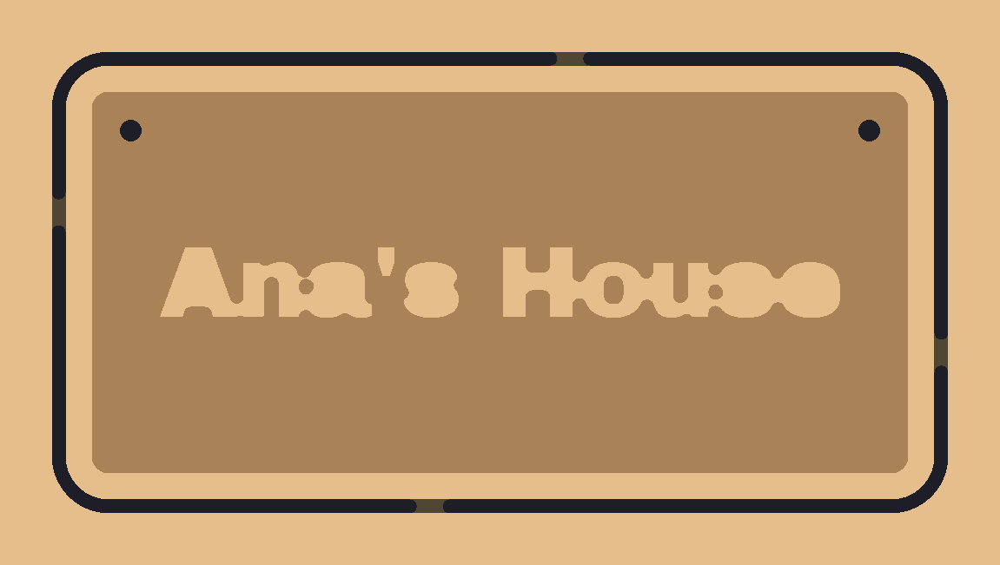

# cam-engine: 2.5D CAM for signs and cut-out lettering

The engine that fixes "gSender can't create anything". It takes the JSON spec the AI assistant fills in and returns **GRBL G-code that has already been verified**. Along with it come manufacturability warnings in plain English and the geometry for the preview.

```
JSON spec  →  2D layout  →  toolpaths  →  GRBL G-code  →  verifier  →  (simulation)
(AI / UI)    (opentype.js    (pocket,      (post-         (re-reads the
              + Clipper2)     profile,      processor)     final text)
                              tabs)
```

It has no UI dependency. It runs in Node (tests, CLI, gSender's server) and in the browser (worker).

## What it does today (v1)

| Feature | How |
|---|---|
| **Sign** with a straight, rounded or chamfered edge | parametric outline |
| **Text** in relief, engraved or cut through (stencil) | `opentype.js` → outlines → NonZero union |
| **Cut-out lettering**, with separate or joined (script) letters | union of the letters + outside profile cut, also cutting out the counters |
| **Icons** (heart, star, house, leaf) | parametric polygons |
| **Holes and slots** for mounting or hanging | peck drilling when the hole is the bit's diameter, otherwise a pocket |
| **Pocket** (relief, engraving) | concentric Clipper2 offset rings, from the inside out, staying at depth between rings when it is safe |
| **Outer profile cut with tabs** | depth passes; the bit lifts over the tabs on the final passes. `tabs: { count, width, height }` spreads them evenly; `tabs.positions` (fractions 0–1 of each outer outline, counter-clockwise from its lowest-left point; see `src/cam/tabs.ts`) places them by hand. The result lists the tabs it left in `result.tabs` |
| **Two bits** (e.g. 1/16" engraves, 1/8" cuts out) | tool change with `T# M6`, handled by gSender |
| **Cutting parameters** per material | RPM, feed rate = chip load × flutes × RPM, plunge rate, stepdown and stepover |
| **Verifier** | allowed commands only, mm/absolute, no `$`, no G0 inside the material, area/Z/feed/RPM limits; estimated time |
| **Simulation** with a heightmap | same idea as `carve.ts` from rudra496/cnc, rewritten without Three.js |

### Manufacturability warnings

Every warning has a stable `code` (for the UI and the AI to react to), a human-readable `message` and a `suggestion`. Examples:

- `TEXT_DOES_NOT_FIT`: includes the suggested size in `data.suggestedSize`.
- `ELEMENT_NOT_MACHINABLE`: the strokes are thinner than the bit and nothing would be cut.
- `DETAIL_SMALLER_THAN_BIT`: reports the % of the area that will not be cut.
- `DEPTH_EXCEEDS`, `TOOL_TOO_SHORT`, `HOLE_SMALLER_THAN_BIT`, `OUTSIDE_PART`, `LOOSE_ISLANDS`, `PART_LARGER_THAN_MACHINE`, `VBIT_ENGRAVE_ONLY`, `SMALL_PART_WITHOUT_TABS`, `TAB_TOO_NARROW`.

With any warning of severity `error`, `generatePlate` returns no G-code (`ok: false`, `gcode: ""`).

## Sienci Labs catalog (`src/catalog/sienci/`)

The tool is built for Sienci machines. With `sienci: { machine, head?, bit, cutoutBit?, speed? }`, the engine uses the real data instead of the generic defaults:

| File | Contents | Source |
|---|---|---|
| `machines.ts` | LongMill MK2 (12×30, 30×30, 48×30), MK3 (30×30, 48×30), AltMill (2×4, 4×4, 4×8): travel, max rate, supported heads and the default one | gSender's firmware defaults ($110–$112, $130–$132) |
| `heads.ts` | Makita RT0701 (manual dial 1–6), AutoSpin T1 (ER11, speed from the G-code), 1.5/2.2 kW ER20 spindles | product pages and resources.sienci.com |
| `bits.ts` | 15 bits from the store (1/16″, 1/8″, 1/4″ straight, compression, single flute, 30/60/90° V-bits, 22 mm surfacing, ball nose) with measurements and link; shank × collet compatibility rule | tables on the sienci.com product pages |
| `table.ts` | Official feeds and speeds table (softwood/MDF, hardwood, plastics × reduced/regular/maximum), converted to mm | resources.sienci.com/view/cnc-feeds-speeds |
| `projects.ts` | 7 first-cut projects, with `projectsForMachine()` telling what fits and which accessories are missing | — |

What changes in generation:
- **Real limits and speeds:** the machine's travel and max rate; the head's spindle speed range.
- **Official parameters:** taken from the Sienci table. The stepdown is the slotting one (conservative) and the plunge rate is capped at 300 mm/min, as Sienci recommends outside 3D carving, because the engine still plunges straight down.
- **Bit compatibility:** `BIT_NEEDS_ACCESSORY` (e.g. 1/8″ in the Makita), `BIT_INCOMPATIBLE`, `BIT_NOT_SUPPORTED` (surfacing and ball nose bits are not for signs).
- **Compression bit:** the stepdown goes up to get past the upcut section (`COMPRESSION_STEPDOWN`).
- **Makita:** `manualAdjustments` gives the dial setting ("set the dial to 3"), which also goes in the G-code header.

All 7 projects generate approved G-code on every machine they fit. The 90 cm address sign only fits the 48×30 machines and the AltMills.

Catalog data checked in Oct 2026. Prices are left out because they change.

## Example simulations

| `anas-house.json` | `pacifico-lettering.json` | `engraved-icons-plate.json` |
|---|---|---|
|  |  |  |
| 3 mm relief, frame, 2 holes, profile cut with 4 tabs | Joined script lettering cut out, with counters and tabs | Engraved with a 1/16", slot and profile cut with a 1/8", chamfered corners |

Colors: beige = untouched surface; brown = cleared; black = cut through.

## Usage

```bash
npm install
npm test                      # 162 tests, including the v1 acceptance criterion and the Sienci projects
npm run generate -- examples/anas-house.json output.nc
npm run render -- output.nc output.png 220 120 15 examples/anas-house.json
```

```ts
import { generatePlate, loadFonts } from "@gsender-next/cam-engine";

const fonts = await loadFonts((file) => fetch(`/fonts/${file}`).then((r) => r.arrayBuffer()));
const res = generatePlate(
  {
    width: 200, height: 100, thickness: 15, material: "mdf",
    texts: [{ content: "Ana's House", size: 16, mode: "relief", depth: 3 }],
    edge: { type: "rounded", radius: 10 },
    holes: [{ x: 15, y: 85, diameter: 5 }, { x: 185, y: 85, diameter: 5 }],
  },
  { fonts, tool: { diameter: 3.175, cutLength: 22 } },
);

res.warnings;     // show in the UI
res.layout;       // geometry for the preview
res.verification; // estimated time, extent, problems
if (res.ok) await fetch("/api/gcode", { method: "POST", body: res.gcode }); // send through gSender's server
```

**Work origin:** X0 Y0 at the bottom-left corner of the stock and Z0 on the top surface. When there is an outer cutout, the stock is the sign plus `margin` (10 mm) on each side.

## Production features

### Keep-out zones (clamps, screws, hold-downs)

`generatePlate(spec, { ..., keepOut: [{ label: "Clamp 1", x, y, width, height, clearance? }] })`, in stock coordinates (x/y = bottom-left corner of the rectangle; `clearance` = obstacle height above the stock top, default 20 mm).

- Any cut overlapping a zone is a `KEEP_OUT_OVERLAP` error pointing at the element (pockets/engravings/cutouts/holes use their own area; the outer profile uses the ring one bit diameter outside the outline).
- Travel height, the simple and safe way: with at least one zone, **both** the safe height and the retract height of the whole job become at least `tallest clearance + 2 mm`, so every G0 (between and within operations) clears every obstacle. The header gets a `; Keep-out zones: …` note. If that height plus the stock thickness exceeds the machine's Z travel: `KEEP_OUT_TOO_TALL` error. Jobs get slower (longer retracts), never unsafe.
- The verifier (`VerifyLimits.keepOut` + `toolRadius`) rejects any move, rapid or feed, arcs included, whose straight XY path enters a zone grown by the largest bit radius while Z is below the zone's clearance (segment clipping, not just end points). `generatePlate` passes the zones in, so `ok` is false if anything enters one.
- Without zones (omitted or `[]`) the G-code is byte-identical to before.

### Batch production from a CSV

`parseCsv(text)` (RFC 4180, BOM, CRLF, `,`/`;`/tab detected) → `generateBatch(template, rows, { ...options, fileNameField?, onProgress? })`. The template's texts carry `{{field}}` placeholders (`templateFields`, `fillTemplate`). Each item is a normal `generatePlate` result named `001-<slug>.nc`; a row that does not fit fails alone (`TEXT_DOES_NOT_FIT`, or `INVALID_SPEC` for other schema errors), texts left empty by a row are dropped, and `totalTimeSec` sums the items that are ok.

### Cost and price

`estimateCost({ timeSec, quantity, material, bits, machineRatePerHour, laborRatePerHour, setupMinutes, finishingMinutesPerPiece, attendedPct, extrasPerPiece, marginPct, platformFeePct })` → per-piece material, bit wear, machine, labor, extras; job totals; `suggestedPrice = total × (1 + margin) / (1 − fee)` rounded up to the next 0.50. Every formula is in the JSDoc of `src/cost.ts`.

## Decisions and known limits

- **Clipper2 via `clipper2-ts`:** the `clipper2-js` package (1.2.4) returned wrong negative offsets (the polygon grew instead of shrinking), so it was dropped.
- **Pocket rings:** each ring comes straight from the original region (erosion by r + k·stepover). Chaining offsets made the vertex count explode (188 thousand points and 110 s on the example sign; now 1.5 s).
- **Straight plunge:** the bit plunges at the plunge rate, with no ramp or helix. This requires a center-cutting end mill. Ramping is planned for v1.1.
- **V-bit:** V-carving with variable depth (the depth follows the stroke width); where it would go past the max depth, the bottom is left flat and cleared with the V-bit.
- **Material presets:** these are conservative starting values. The UI should allow adjusting them and remember the adjustment per material.
- **Machine limits:** the default is generic (300 × 300 mm). When integrating, fill `machine` with the firmware settings read by gSender ($110–$112 max rates, $130–$132 travel).
- **Not yet tested on a real machine.** Validation so far is the verifier plus the simulation.

## What came from rudra496/cnc

No files were copied. Two ideas were reused (MIT license):
- the material removal simulation with a heightmap (`src/sim/heightmap.ts`, at 0.25 mm instead of the 120×120 grid);
- the feed rate formula from the calculator (`src/materials.ts`).

## Bundled fonts

Archivo Black, Pacifico and Bebas Neue, all under the SIL Open Font License (licenses in `fonts/*/OFL.txt`).
